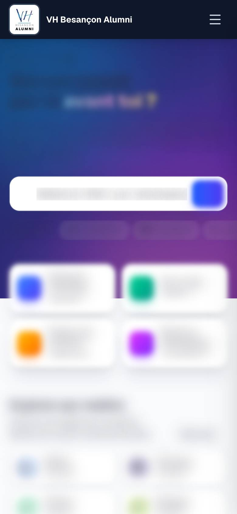
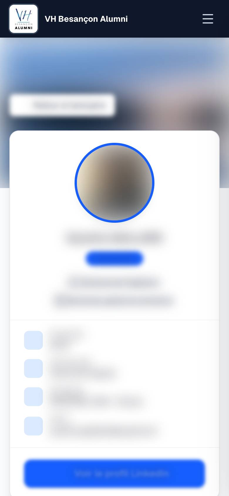
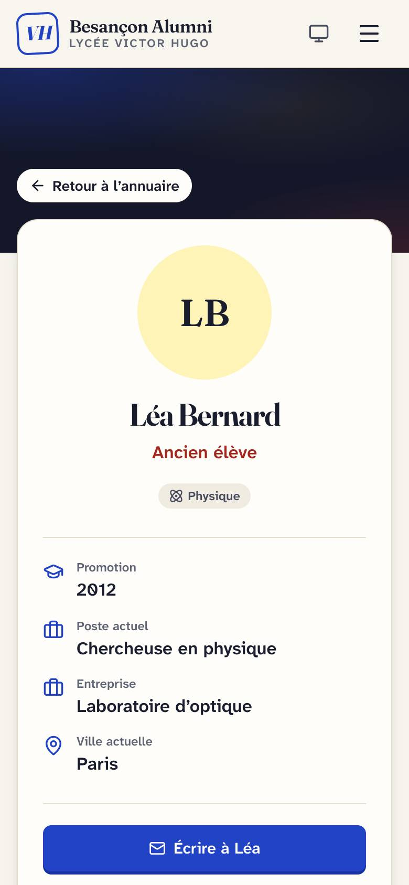
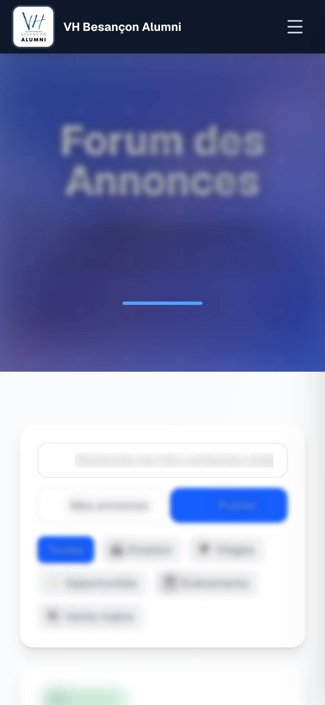

# REPORT — Refonte du site VH Besançon Alumni

Branche `rebuild`, à fusionner dans `main` par la PR associée **après** les
étapes de mise en production ci-dessous. Voir aussi [MAP.md](MAP.md) (état
d'origine), [PARITY.md](PARITY.md) (checklist vérifiée),
[DECISIONS.md](DECISIONS.md) (choix et justifications) et
[DESIGN.md](DESIGN.md) (identité « Cahier de parcours »).

## 1. En bref

| Objectif | État |
|---|---|
| Refonte UX/UI (identité, ergonomie, accessibilité) | Fait. Design system « Cahier de parcours », parcours raccourcis, validation en direct, mode sombre, WCAG AA visé (scores ci-dessous) |
| Sortie de Sanity | Fait dans le code : plus aucune dépendance Sanity. PostgreSQL + Drizzle, images sur Vercel Blob, administration sur le site (édition sur place, brouillons, historique, tableau de bord `/admin`) |
| Zéro régression fonctionnelle | 116 fonctionnalités sur 125 vérifiées ; 9 écarts signalés et justifiés (§ 6), dont 6 dépendent de services externes absents en local |
| Comptes et mots de passe conservés | Fait : 100 comptes, 62 hash bcrypt recopiés à l'identique, vérifiés octet par octet ; rehash transparent à la connexion |
| Build, lint, typecheck, tests | Tous au vert (§ 2) |
| Performance | Mobile 89 → 90, ordinateur 99 → 100, accessibilité 93 → 100 (§ 4) |
| Mise en production | **Pas faite** : elle demande une base et un stockage de production, et votre feu vert (§ 7) |

## 2. Vérifications

| Contrôle | Résultat |
|---|---|
| `npm run typecheck` | 0 erreur |
| `npm run lint` | 0 erreur, 0 avertissement |
| `npm run build` | OK (aucun avertissement de traçage de fichiers) |
| `npm test -- --run` (Vitest) | 334 tests, tous au vert |
| `npm run test:e2e` (Playwright, build de production) | 36 scénarios, tous au vert |

**Ce que couvrent les tests**
- **Authentification** : connexion avec un hash d'origine `$2b$10$`, rehash
  transparent, même message pour un e-mail inconnu et un mot de passe faux,
  comptes en attente ou suspendus, limitation des tentatives, mot de passe
  oublié (lien unique, expiration), inscription.
- **Permissions** : chacune des 23 actions d'administration est appelée
  directement par un visiteur, un membre, et un membre dont le jeton se
  prétend administrateur : toutes refusées, seul un vrai administrateur
  passe. Un administrateur rétrogradé ou suspendu perd l'accès malgré son
  jeton, et le dernier administrateur ne peut pas être rétrogradé. Côté
  membres, chacun ne modifie que ses propres annonces, témoignages et
  profil, et le CSRF est exigé sur toute écriture.
- **Migration** : instantané Sanity fictif importé deux fois (aucun doublon),
  hash conservés, comptes Studio, rôle admin jamais retiré, brouillon du
  nouveau site préservé, décomptes vérifiés.
- **Parcours e2e** : visiteur, inscription puis validation par un
  administrateur, annuaire (recherche, suggestions au clavier, filtres dans
  l'URL), profil, annonces, témoignages, paramètres, suppression de compte,
  profil lycéen, menu mobile, aucun débordement horizontal sur mobile.
- **Édition sur place** : brouillon invisible des visiteurs, publication,
  restauration depuis l'historique, remplacement d'image par téléversement,
  article créé en brouillon puis publié.

**Bugs trouvés par ces tests, et corrigés**

| Problème | Conséquence évitée |
|---|---|
| Pages `/connexion` et `/inscription` en erreur sur le build de production (fonction client appelée côté serveur) | Plus personne ne pouvait se connecter après le déploiement |
| Pages vues refusées (jeton CSRF absent) | Statistiques de fréquentation vides |
| Menu « Plus d'actions » de la barre d'édition invisible sur ordinateur | Historique et restauration inaccessibles |
| Pas de « version d'origine » dans l'historique | Impossible de revenir au texte de départ après une première publication |
| Pages introuvables servies avec un code 200 | Fausses pages indexables |
| Administration qui débordait sur mobile | Défilement horizontal |
| E-mails réellement envoyés depuis l'environnement local (identifiants Gmail dans `.env.local`) | Un test aurait écrit à de vrais membres |
| Build qui embarquait tout le dépôt dans le code serveur | Déploiement plus lent et plus lourd |
| Boucle de redirections pour un membre supprimé ou suspendu pendant sa session | Page inaccessible (« trop de redirections ») |
| Configuration Sentry du navigateur plus chargée avec Turbopack (déjà le cas sur `main`) | Erreurs du navigateur jamais remontées |
| Code d'édition et schémas Zod téléchargés par chaque visiteur | Performance mobile en baisse (81 au lieu de 89) |

## 3. Migration des données

Exécutée **en local uniquement** : export Sanity en lecture seule, puis import
dans PostgreSQL (PGlite) et vérification (`npm run migrate:verify`, résultat
dans [docs/migration-report.json](docs/migration-report.json)).

| Type Sanity | Avant (Sanity) | Après (PostgreSQL) | Remarque |
|---|---:|---:|---|
| Comptes (`user`) | 100 | 100 | |
| Hash de mots de passe | 62 | 62 | identiques octet par octet |
| E-mails | 100 | 100 | normalisés en minuscules |
| Comptes actifs / en attente | 99 / 1 | 99 / 1 | |
| Membres du bureau | 5 | 5 | |
| Articles (`post`) | 20 | 20 | Portable Text converti en HTML assaini |
| Annonces | 3 | 3 | |
| Témoignages | 3 | 3 | |
| Abonnements newsletter | 33 | 33 | |
| Jetons de réinitialisation | 17 | 17 | tous expirés ; conservés hachés |
| Journal d'activité | 1 674 | 1 674 | |
| Images (`sanity.imageAsset`) | 69 | 69 | fichiers copiés et présents dans le stockage |
| Références d'images | 47 | 47 | photos, couvertures, illustrations |
| Références orphelines | 0 | 0 | |

Non migrés, volontairement : les documents système Sanity
(`system.group` ×11, `system.retention` ×1) et les brouillons Sanity
(`drafts.*`), que les visiteurs ne voyaient pas.

**Comptes du Studio Sanity.** Deux membres administrateurs (une seule adresse
e-mail) et un robot (jeton d'API, ignoré). Leurs mots de passe **ne sont pas
récupérables** : le Studio s'authentifie chez Sanity, qui n'expose aucun
hash. L'import crée donc un compte administrateur sans mot de passe,
invisible dans l'annuaire, à inviter depuis `/admin/utilisateurs` (« Envoyer
une invitation », lien à usage unique valable 7 jours).

## 4. Lighthouse avant / après

Mesures locales de l'ancien site (`main`, données Sanity) et du nouveau
(build de production, base migrée, mêmes volumes), avec Lighthouse 13.5.0,
sur les mêmes pages et avec un compte membre. Résultats bruts :
[docs/perf/before.json](docs/perf/before.json) et
[docs/perf/after.json](docs/perf/after.json) ; tableau généré par
`node tools/perf/compare.mjs`.

**Mobile** (médiane de 3 passages)

| Page | Performance | Accessibilité | Bonnes pratiques | SEO | LCP | CLS |
|---|---|---|---|---|---|---|
| Accueil (visiteur) | 94 → **90** (-4) | 95 → **100** (+5) | 96 → **100** (+4) | 92 → **100** (+8) | 3.1 → **3.5** s | 0 → **0** |
| À propos | 87 → **91** (+4) | 96 → **100** (+4) | 96 → **100** (+4) | 92 → **100** (+8) | 4.0 → **3.5** s | 0 → **0** |
| Connexion | 90 → **91** (+1) | 91 → **100** (+9) | 96 → **100** (+4) | 92 → **100** (+8) | 3.6 → **3.4** s | 0 → **0** |
| Accueil membre | 87 → **88** (+1) | 97 → **100** (+3) | 100 → **100** (=) | 100 → **100** (=) | 3.9 → **3.7** s | 0 → **0** |
| Annuaire | 88 → **88** (=) | 93 → **100** (+7) | 100 → **100** (=) | 100 → **100** (=) | 3.8 → **3.7** s | 0 → **0** |
| Fiche membre | 89 → **92** (+3) | 95 → **100** (+5) | 100 → **100** (=) | 100 → **66** (-34) | 3.8 → **3.3** s | 0 → **0** |
| Annonces | 88 → **91** (+3) | 95 → **98** (+3) | 100 → **100** (=) | 100 → **100** (=) | 3.9 → **3.4** s | 0 → **0** |
| Témoignages | 88 → **91** (+3) | 95 → **98** (+3) | 100 → **100** (=) | 100 → **100** (=) | 3.9 → **3.5** s | 0 → **0** |
| Blog | 87 → **88** (+1) | 84 → **100** (+16) | 100 → **100** (=) | 100 → **100** (=) | 4.1 → **3.9** s | 0 → **0** |
| **Moyenne** | 89 → **90** (+1) | 93 → **100** (+7) | 99 → **100** (+1) | 97 → **96** (-1) | | |

**Ordinateur** (médiane de 3 passages)

| Page | Performance | Accessibilité | Bonnes pratiques | SEO | LCP | CLS |
|---|---|---|---|---|---|---|
| Accueil (visiteur) | 99 → **100** (+1) | 94 → **100** (+6) | 96 → **100** (+4) | 92 → **100** (+8) | 0.9 → **0.7** s | 0 → **0** |
| À propos | 99 → **100** (+1) | 96 → **100** (+4) | 96 → **100** (+4) | 92 → **100** (+8) | 0.8 → **0.8** s | 0 → **0** |
| Connexion | 100 → **100** (=) | 91 → **100** (+9) | 96 → **100** (+4) | 92 → **100** (+8) | 0.6 → **0.8** s | 0 → **0** |
| Accueil membre | 99 → **100** (+1) | 97 → **100** (+3) | 100 → **100** (=) | 100 → **100** (=) | 1.0 → **0.8** s | 0 → **0** |
| Annuaire | 99 → **99** (=) | 93 → **100** (+7) | 100 → **100** (=) | 100 → **100** (=) | 0.9 → **0.8** s | 0 → **0** |
| Fiche membre | 100 → **100** (=) | 95 → **100** (+5) | 100 → **100** (=) | 100 → **66** (-34) | 0.8 → **0.7** s | 0 → **0** |
| Annonces | 99 → **100** (+1) | 95 → **98** (+3) | 100 → **100** (=) | 100 → **100** (=) | 1.0 → **0.8** s | 0 → **0** |
| Témoignages | 98 → **99** (+1) | 95 → **98** (+3) | 100 → **100** (=) | 100 → **100** (=) | 1.0 → **0.8** s | 0 → **0** |
| Blog | 99 → **99** (=) | 88 → **100** (+12) | 100 → **100** (=) | 100 → **100** (=) | 0.9 → **0.9** s | 0 → **0** |
| **Moyenne** | 99 → **100** (+1) | 94 → **100** (+6) | 99 → **100** (+1) | 97 → **96** (-1) | | |


**Lecture**
- **Accessibilité 93 → 100**, bonnes pratiques et SEO à 100 sur toutes les
  pages publiques (`robots.txt` et plan du site ajoutés).
- **Performance** : ordinateur 99 → 100, mobile 89 → 90 en moyenne ; huit
  pages sur neuf sont égales ou meilleures. Seul l'accueil visiteur sur
  mobile est légèrement en dessous (94 → 90), à cause de la photo
  principale, plus grande, et des polices de la nouvelle identité.
- **Ce qui a été corrigé pour y arriver** (premières mesures : mobile 81) :
  - code d'édition et schémas chargés à la demande ;
  - Fraunces limitée au sous-ensemble latin et aux axes utiles (220 → 65 Ko) ;
  - plugin Sentry seulement avec un DSN ;
  - image principale en priorité haute ;
  - plus de squelette de chargement sur les pages membres (DOM doublé).
- **Voulu** : la fiche d'un membre est marquée `noindex` (données
  personnelles), d'où son score SEO de 66. Elle reste de toute façon
  réservée aux membres connectés.

## 5. Captures d'écran

Le dépôt étant public, aucune donnée de membre n'y figure :
- **avant, pages membres** : vraies données Sanity, **textes et photos
  floutés** (seule la mise en page reste visible) ;
- **après, pages membres** : base de test peuplée de **membres fictifs** ;
- **pages publiques** : contenus déjà publics, sans flou.

| Page | Avant (mobile) | Après (mobile) | Ordinateur |
|---|---|---|---|
| Accueil visiteur |  |  | [avant](docs/screenshots/before/accueil-visiteur-desktop.jpg) · [après](docs/screenshots/after/accueil-visiteur-desktop.jpg) |
| À propos |  |  | [avant](docs/screenshots/before/a-propos-desktop.jpg) · [après](docs/screenshots/after/a-propos-desktop.jpg) |
| Connexion |  |  | [avant](docs/screenshots/before/connexion-desktop.jpg) · [après](docs/screenshots/after/connexion-desktop.jpg) |
| Accueil membre |  |  | [avant](docs/screenshots/before/accueil-membre-desktop.jpg) · [après](docs/screenshots/after/accueil-membre-desktop.jpg) |
| Annuaire |  |  | [avant](docs/screenshots/before/annuaire-desktop.jpg) · [après](docs/screenshots/after/annuaire-desktop.jpg) |
| Fiche membre |  |  | [avant](docs/screenshots/before/fiche-membre-desktop.jpg) · [après](docs/screenshots/after/fiche-membre-desktop.jpg) |
| Annonces |  |  | [avant](docs/screenshots/before/annonces-desktop.jpg) · [après](docs/screenshots/after/annonces-desktop.jpg) |
| Témoignages |  |  | [avant](docs/screenshots/before/temoignages-desktop.jpg) · [après](docs/screenshots/after/temoignages-desktop.jpg) |
| Blog |  |  | [avant](docs/screenshots/before/blog-desktop.jpg) · [après](docs/screenshots/after/blog-desktop.jpg) |

## 6. Parité : écarts justifiés

Le détail ligne par ligne est dans [PARITY.md](PARITY.md).

| Fonctionnalité | Écart | Justification / suite |
|---|---|---|
| A11–A13 Connexion Google et LinkedIn, création de compte OAuth | Non testée de bout en bout | Code repris (rattachement par e-mail, choix du type, compte en attente). Nécessite les vrais fournisseurs : à vérifier sur le déploiement de prévisualisation, avec les URL de rappel autorisées chez Google et LinkedIn. |
| K6–K7 Sentry | Non testé | Aucun DSN n'est défini sur le projet Vercel : Sentry ne recevait déjà rien en production. La configuration navigateur est corrigée (`instrumentation-client.ts`) et le plugin ne s'active qu'avec un DSN. Il suffit d'ajouter `NEXT_PUBLIC_SENTRY_DSN` et `SENTRY_DSN` pour le réactiver. |
| L1 Export quotidien vers Google Drive | Non testé | Code inchangé ; identifiants Google Drive absents en local. L'export CSV, lui, est testé. |
| M10 Consulter les jetons de réinitialisation | Retiré | Les jetons sont désormais stockés hachés : les afficher n'a plus de sens. Un administrateur peut envoyer un lien de réinitialisation depuis la fiche du membre. Le journal d'activité reste consultable. |
| M13 Requêtes GROQ libres (Vision) | Pas d'équivalent | Couvert par l'export CSV, les statistiques et la console SQL de l'hébergeur (Neon) pour un besoin technique ponctuel. |
| M14 Accès au Studio (administrateur / éditeur) | Rôles simplifiés | Deux rôles sur le site : administrateur et membre. Le seul « éditeur » était un robot d'API. |

Les changements volontaires de comportement (blog public, annuaire limité aux
comptes actifs, liens d'inscription masqués pour les membres, suppression en
cascade…) sont listés dans [DECISIONS.md](DECISIONS.md) § 8 et § 9.

## 7. Mise en production

**État au 21/10/2026 (feu vert donné) :**
- ✅ Base **Neon** `alumni-db` (offre gratuite, Francfort `eu-central-1`),
  reliée **uniquement** à l'environnement *Production* : une prévisualisation
  ne peut pas écrire dedans.
- ✅ Stockage **Vercel Blob** `alumni-media` (public, Francfort), relié à
  *Production*.
- ✅ Tables créées, export Sanity du jour importé, vérification entièrement
  au vert ([docs/migration-report-production.json](docs/migration-report-production.json)) :
  100 comptes, 62 hash identiques, 1 676 journaux, 69 images sur Blob.
- ✅ Build de production testé en local sur la vraie base et le vrai
  stockage : `/api/health` « healthy », images servies par Blob.
- ✅ Fonctions Vercel déplacées à Francfort (`vercel.json`), à côté de la
  base.
- ✅ PR fusionnée et déployée : 14 contrôles sur 14 en ligne, `/api/health`
  « healthy », fonctions servies depuis Francfort (`fra1`).
- ⚠️ **Incident** : le premier déploiement a réutilisé le cache de build de
  l'ancien site, et le cache Turbopack a servi l'ancienne feuille de style.
  Le site est resté sans mise en page **environ 10 minutes**. Corrigé par un
  redéploiement sans cache (`VERCEL_FORCE_NO_BUILD_CACHE=1`, retiré
  ensuite). Les builds suivants repartent d'un cache de la refonte.
- ✅ Administrateurs : **Adam Taieb** (`contact@ataieb-dev.fr`, mot de passe
  et LinkedIn) et **Camille Schneider** (Google), nommés avec
  `tools/admin/set-role.ts`. Le compte repris du Studio (même personne
  qu'Adam, autre adresse) n'a pas été invité, puisqu'Adam est déjà
  administrateur. Pour l'activer : `tools/admin/invite.ts`.

Les étapes détaillées ci-dessous restent valables pour une nouvelle
installation ou pour relancer l'import.

La fusion dans `main` déclenche un déploiement de production. Elle doit
donc **suivre** les étapes 1 à 5. Rien n'est supprimé côté Sanity : en cas
de problème, il suffit d'annuler la fusion (étape 8).

### 1. Provisionner la base et le stockage (Vercel)
1. Projet Vercel `alumni` › **Storage** › *Create Database* › **Neon**
   (Marketplace), région **Europe (Francfort)**, pour garder les données
   dans l'UE comme avec Sanity (Belgique). Connecter le projet aux
   environnements *Production* et *Preview* : `DATABASE_URL` est ajoutée
   automatiquement.
2. **Storage** › *Create* › **Blob** (magasin public), connecté au projet :
   `BLOB_READ_WRITE_TOKEN` est ajoutée automatiquement.

### 2. Variables d'environnement
Modèle complet : [.env.example](.env.example). À vérifier dans
*Project › Settings › Environment Variables* :

| Variable | Production | Remarque |
|---|---|---|
| `DATABASE_URL` | obligatoire | ajoutée par Neon |
| `BLOB_READ_WRITE_TOKEN` | obligatoire | ajoutée par Blob |
| `AUTH_SECRET` (ou `NEXTAUTH_SECRET`) | obligatoire | conserver la valeur actuelle : les sessions en cours restent valides |
| `NEXTAUTH_URL`, `NEXT_PUBLIC_BASE_URL` | obligatoire | `https://www.vh-besancon-alumni.fr` |
| `EMAIL_USER`, `EMAIL_PASSWORD`, `ADMIN_EMAIL` | obligatoire | inchangées |
| `CRON_SECRET` | obligatoire | inchangée |
| `GOOGLE_*`, `LINKEDIN_*` | facultatif | inchangées |
| `CLIENT_ID`, `CLIENT_SECRET`, `GOOGLE_REFRESH_TOKEN`, `GOOGLE_DRIVE_FOLDER_ID` | facultatif | export Drive, inchangées |
| `ADMIN_EMAILS` | à l'import | e-mails à nommer administrateurs |
| `NEXT_PUBLIC_SANITY_*`, `SANITY_API_TOKEN`, `SANITY_WEBHOOK_SECRET` | à retirer **après** la bascule | plus lues par le code ; garder le jeton jusqu'à la fin de la migration |

### 3. Créer les tables puis migrer
Depuis un poste avec le dépôt (branche `rebuild`, `npm ci` fait) :
```bash
vercel env pull .env.production.local --environment=production
```
```bash
npx tsx --env-file=.env.production.local tools/db/migrate.ts
```
```bash
npx tsx --env-file=.env.production.local tools/migration/export-sanity.ts
```
```bash
ADMIN_EMAILS="adresse1@exemple.fr" npx tsx --env-file=.env.production.local tools/migration/import.ts
```
```bash
npx tsx --env-file=.env.production.local tools/migration/verify.ts
```
`.env.production.local` contient des secrets : ne jamais le versionner
(il est ignoré par git) et le supprimer une fois la migration terminée.
Chaque ligne de `migrate:verify` doit afficher ✔. L'import peut être relancé
sans risque : par exemple juste avant la fusion, pour reprendre les comptes
créés entre-temps sur l'ancien site.

> Conseil : faire une première répétition sur une **branche Neon** (copie
> gratuite de la base), connectée au déploiement de prévisualisation de la
> PR. Cette étape n'a pas pu être testée ici faute de PostgreSQL local : les
> migrations SQL ont été vérifiées sur PGlite (moteur PostgreSQL 17).

### 4. Vérifier le déploiement de prévisualisation
Constat sur le projet Vercel (lecture du 21/10) : Git relié à
`ataieb3342/alumni`, branche de production `main`, Node 22, aucun stockage,
aucune `DATABASE_URL`, aucun DSN Sentry, et des variables de
*Preview* identiques à celles de production. Avant de tester la
prévisualisation :
- *Preview* › `DATABASE_URL` : une **branche Neon** (copie de la base), jamais
  la base de production ;
- *Preview* › `EMAIL_TRANSPORT=log` : la branche contient les vrais membres,
  et valider un compte de test leur écrirait vraiment ;
- *Preview* › retirer `NEXTAUTH_URL` et définir `AUTH_TRUST_HOST=true`, pour
  que la connexion reste sur l'URL de prévisualisation au lieu de renvoyer
  vers le site de production.

Sur l'URL de prévisualisation de la PR :
- se connecter avec un compte existant ;
- ouvrir l'annuaire et une fiche ;
- passer en mode édition et publier une modification de test, puis la
  restaurer depuis l'historique ;
- se connecter avec Google et LinkedIn (après avoir autorisé l'URL de rappel).

### 5. Mettre à jour les pages légales
Mentions légales et politique de confidentialité : remplacer « l'hébergeur de
la base retenu par l'association » par **Neon Inc., région Francfort (UE)**.
Ces pages se modifient directement sur le site (mode édition).

### 6. Basculer
1. Annoncer une courte période sans inscription sur l'ancien site, ou relancer
   l'import juste avant la fusion.
2. Fusionner la PR dans `main` : Vercel déploie en production.
3. Inviter les administrateurs du Studio (`/admin/utilisateurs`).
4. Vérifier `/api/health` (base, stockage, e-mail : « healthy »).

### 7. Tâches planifiées
`vercel.json` est inchangé : export Drive à 2 h, rappels de profil à 9 h,
protégés par `CRON_SECRET`.

### 8. Retour arrière
Annuler la fusion (*Revert* de la PR), ou promouvoir l'ancien déploiement
dans Vercel (*Instant Rollback*). Sanity n'ayant rien perdu, l'ancien site
repart tel quel. Les inscriptions faites entre-temps sur le nouveau site
seraient à reprendre à la main.

### Après la bascule (plus tard)
- Retirer les variables Sanity et révoquer le jeton d'API Sanity.
- Ne fermer le projet Sanity qu'après quelques semaines, une fois l'export
  archivé.

## 8. Points d'attention

- **Scripts locaux** : `scripts/` (non versionné) contient encore trois
  scripts basés sur Sanity : `backfill-subjects`, `export-members`,
  `create-event-relance`. Ils sont à porter sur la nouvelle base s'ils servent
  encore. L'export des membres existe déjà dans l'administration.
- **Limitation de débit** en mémoire, par instance Vercel. Upstash Redis la
  rendrait globale si des abus apparaissaient.
- **Images publiques** sur Vercel Blob, comme sur le CDN Sanity. Des URL
  signées seraient possibles si l'association souhaite restreindre les photos
  de profil aux membres.
- **Dépôt public** : aucune donnée de membre n'est versionnée. Les captures
  des pages membres réelles sont floutées.
